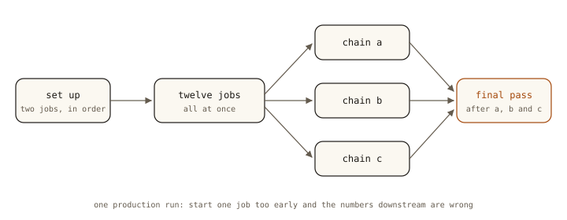
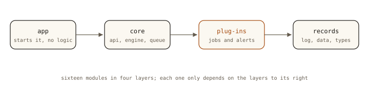
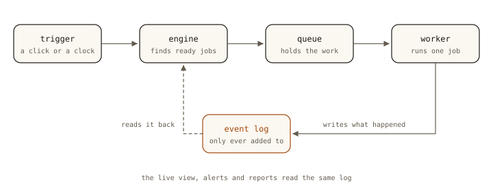
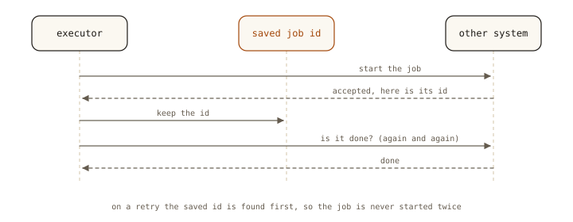

A finance data platform had to run dozens of jobs in a strict order, and people were running them by hand. This is how I designed and built the system that runs them now, and what I learned doing it alone with AI agents.

## The problem {#problem}

The platform takes data from upstream systems (logistics, sourcing, contracts), moves it through a long chain of migration and calculation jobs, and hands the result to finance systems downstream. The order of those jobs matters. If one starts before the jobs it depends on have finished, the numbers downstream are wrong.

Every run was done in Postman. An engineer started one request, waited for the answer, checked it, then started the next. They tracked progress in a document. A three-hour run meant three hours at the desk, and a failure halfway meant working out by hand what had already finished.

There was no retry, no parallel running, no record of what happened and no way to run at night without someone awake. The team knew the workflows well. What it lacked was a system that could hold that knowledge and enforce it.

## Build or buy {#build-or-buy}

I looked at the obvious options first.

- **A commercial enterprise scheduler.** Used elsewhere in the organisation, but not licensed for this team. It also had no built-in way to start a job, get an ID back and keep checking it for hours.
- **Apache Airflow.** Workflows written in Python, no separation between teams, and a heavy Python stack for a Java team.
- **Temporal.** Each workflow is code, so every new one needs a developer. There is no visual builder.
- **Cloud step functions.** Tied to one cloud, and we had to run in our own Kubernetes.
- **Spring Batch.** Made for data pipelines inside one application, not for coordinating calls across services.

Each one missed something we needed. So I wrote down ten requirements and built against them:

1. Dependencies between jobs and between groups of jobs
2. Jobs in a group run at the same time
3. Jobs that return an ID and must be checked for hours
4. No one has to watch a run
5. A failure doesn't mean starting again from the beginning
6. Many teams, each kept apart from the others
7. Open source and self-hosted, with no new licences
8. A person can approve risky steps before they run
9. Blackout windows when nothing may start
10. SQL jobs as well as HTTP jobs

Those ten lines shaped every decision after.

## The shape of it {#shape}

The backend is Java 21 and Spring Boot 3, split into sixteen Maven modules. The split is a rule, not tidiness. Dependencies only point one way, a build check stops any cycle, and a new kind of job is one new module with no change anywhere else.

- **App** starts everything and holds no logic.
- **Core** is the REST API with its security, the engine that decides what runs next, and the queue.
- **Plug-ins** are the job types (HTTP and SQL), the retry and circuit-breaker layer, and four kinds of notification: core, email, webhook and in-app.
- **Records** are the event log, the database layer, the domain types and a shared library with no dependencies at all.

A few choices underneath:

- **Virtual threads.** Jobs spend most of their time waiting on the network or the database. Each runs on a Java 21 virtual thread that parks while it waits, so 50 jobs can run at once without tuning a thread pool.
- **RabbitMQ** carries the work. It was already in place, and its delayed messages and dead-letter queue give retries and failed-message capture for free.
- **Quartz** runs the schedules and keeps them in the same database, so they survive a restart.
- **Liquibase** owns every schema change, and Hibernate only checks the schema. The 34 migrations run on PostgreSQL in development and Oracle in production, so nobody needs an Oracle licence on their laptop.
- **One build, three shapes.** All-in-one for local work, API-only pods that scale with requests, and worker-only pods that scale with the length of the queue.

## How a run moves {#run}

The engine answers one question over and over: which jobs are ready now? It works in three modes. In **DAG mode** each job lists the jobs it waits for. In **grouped mode** jobs belong to groups and groups wait for groups, which matches how the real runs were planned. **Standalone mode** runs single jobs on their own schedules. Each link can mean "wait for all of these to succeed" or "wait for any of them", so a tolerant workflow can carry on past one failed branch.

The choice I am happiest with: **there is no status column**. Every start, success, failure and retry is a new row in a log that is only ever added to, and the engine works out each job's state by reading it. A status can't drift away from what really happened, and the engine can restart at any moment and pick up exactly where it was.

Two smaller rules keep it safe:

- **Checking twice is harmless.** Jobs already sent are filtered out before anything is queued, so a repeated check or a message delivered twice never runs a job twice.
- **Empty groups don't block.** A group with nothing enabled counts as done, and that passes down the line, so a switched-off group never holds up the rest.

## Job types {#job-types}

The engine never knows what a job does. Every job type implements one small interface: which type it handles, whether it is switched on, and how to run. At startup a registry finds them all.

- **HTTP**, using a non-blocking client, in three modes: wait for the answer, start and check, or start and wait for a call back.
- **SQL**, with a connection pool for each target database.
- **Shell scripts**, fetched from cloud storage.
- **Cloud functions**, called with a signed identity token.

Job types keep no state of their own. Everything a job needs (address, credentials, timeout, retry rules) travels with it, so any worker can run any job. Each job type decides whether a failure is worth retrying, which keeps the engine simple. A job can also pick values out of its answer and pass them to later jobs, so a run becomes a small pipeline.

## Jobs that take hours {#long-jobs}

This was the need that ruled most tools out. Many jobs answer at once with "accepted" and an ID, then keep working in the other system for two or three hours.

- **Start and check.** The executor starts the job, reads the ID from the answer, saves it, and asks a status address at a set interval until the answer matches a rule such as "status is complete". After a few errors in a row it waits longer between asks, so it doesn't hammer a struggling system.
- **Start and wait.** The executor adds a callback address to the request, as a field, a query value or a header (whatever the other system expects), and waits for the call back.

The important part is retrying safely. Many of these systems would do the work twice if asked twice. So a retry looks for the saved ID first. If it is there, the start is skipped and the checking carries on. The executor also records "started" straight away, so the stuck-job monitor can tell a job that is waiting from one that has hung.

## When things fail {#failure}

Short failures are normal in batch work. Every outgoing call goes through Resilience4j, set up in code rather than with annotations so the rules can differ from job to job.

- **One circuit breaker per service, not per job.** When a host starts failing, the breaker opens once, and every job that calls that host fails fast instead of each one waiting out its own timeout.
- **Retries per job**, waiting longer each time. Client errors such as 400, 401, 403 and 404 aren't retried by default, because trying again won't fix them.
- **A timeout per job**, so nothing hangs forever.

If a run still fails, it resumes from the failed job. Nothing that already succeeded runs again.

## Schedules, blackouts and approvals {#control}

**Schedules.** Quartz runs in cluster mode on the shared database, and a database lock makes sure exactly one pod fires each schedule, however many pods are running. A schedule never overlaps itself. A missed fire is skipped by default, because replaying last night's batch by surprise would be worse than missing it. A workflow that must run after an outage can choose to fire once on recovery.

**Blackout windows.** Before any run starts, the system checks for a blackout (across the platform or for one workflow) and for the workflow's limit on runs at once. It checks again when the schedule fires, to cover the moment between switching a workflow off and its schedule being removed.

**Approvals.** Any job can need a person's sign-off. When it becomes ready, the engine records that it is waiting instead of sending it, the run pauses, and the approvers are told. A small scanner looks for decisions every ten seconds. Approve, and the job goes through the normal path. Reject, and it fails and everything that waits on it stops. Each request is marked once it is handled, and the scanner checks the job is still waiting before it acts, so a restart can't run anything twice.

## Watching a run {#watching}

The point of all this is that someone can press start and walk away. Every change is sent to the browser as it happens, using Server-Sent Events: one stream for the whole platform, one for a single run, and one for each person's notifications.

I chose Server-Sent Events over WebSockets on purpose. Updates only go one way, it is plain HTTP that passes through the ingress without special setup, and the browser reconnects on its own.

The event log never talks to the browser directly. After each write it raises an application event, and the live view, email, webhooks and inbox each listen for it. Adding a new listener touches nothing in the engine. If one browser has gone away, the error is logged and nothing else is affected.

The same log makes the **run reports**: each job's timing, attempts, response code, duration and error, as PDF, CSV or JSON. A missed time target is marked when the job finishes and stored with the event, so the verdict never changes later. With more than 40 kinds of event, anyone can see exactly what happened in a run and who approved what.

## Teams and access {#access}

Many teams share one platform, and each one sees only its own work.

- **No sessions.** The API checks a company-issued token on every request, for both who issued it and who it is for. No cookies, no API keys, nothing to share between pods.
- **No sign-up.** On first sign-in the user is created and their directory groups become team roles. The group lookup sits behind an interface, so another identity provider could be swapped in.
- **Four roles.** Platform admin, team owner, maintainer and viewer. Owners manage members and workflows, maintainers run and approve, viewers only read.
- **Two locks.** A check runs before each operation, and every database query is filtered to the user's teams, so another team's data is never even loaded.

Some of the work I kept for myself rather than handing to an agent: encrypting sensitive job settings at rest, refusing to start without the key, protecting against server-side request forgery, a certificate store that fixes itself when a job's address needs a new certificate, admin endpoints on a port the outside can't reach, API docs switched off in production, and structured logs with a trace ID on every line.

## The screens {#screens}

The frontend is Next.js with the App Router, React 19, strict TypeScript, Tailwind v4 and shadcn/ui. It does more than show the API.

- **A visual workflow editor**, built on React Flow with Dagre for layout. Teams drag jobs onto a canvas and draw the links between them. There are three layouts (flat, by group, and in rows by depth), and positions are worked out from the links every time rather than saved, so tidying the picture never changes the workflow. Viewing and editing are separate, so watching a run can't change it by accident.
- **A live run view** that colours each job as its events arrive.
- **A dashboard** with widgets you can move and resize, and charts of past runs.
- **A job library** with bulk import from CSV, a cron builder that reads back in plain words, circuit breaker status, blackout windows, team management and built-in docs.

Sign-in uses OpenID Connect through NextAuth. A small proxy passes the token to the backend and drops cookies it doesn't need, because a large token plus a session cookie was going over the server's header limit. Each person's teams and roles load once at sign-in, so pages make no extra permission calls.

## Building it with agents {#agents}

The other half of the story is how it was built. Sixteen modules, 13 screens, about 200 endpoints, 34 migrations and about 74,000 lines, shipped to production by one person in under eight weeks, with GitHub Copilot in plan and agent modes. The split of work was deliberate:

- **Mine:** studying the manual process, the ten requirements, every security decision, deployment, Helm, monitoring and health checks.
- **Shared:** the module layout, the database plan and the job-type interface. The agent drafted, I decided.
- **The agent's, reviewed by me:** the product spec in plan mode, then the backend core, the frontend base, each feature screen, and the features added after release.

Three habits made it work.

1. **Plan first.** The spec was the contract. Every agent session was scoped to one module or one feature from the plan, never an open request. Most arguments about design were settled before there was any code.
2. **Written memory.** A codebase this size doesn't fit in one context window. I kept notes as Markdown files next to the code: module rules, build commands, auth patterns, known traps and work in progress. Every session started from them, so the agent stayed consistent across nearly 40 releases.
3. **Clear ownership.** The agent did the structured, repeated work: modules, entities, controllers, migrations, typed API clients, pages. I kept anything that touched trust or production risk. Reviews were quick, because the plan had already made the hard calls.

> The agent gave me volume. The judgement stayed mine, and that is why the speed didn't cost quality.

My estimate, not a measurement: a usual team of three or four would need around 160 to 215 person-days. This took about 35 to 45. After release, new features such as SQL jobs, platform-wide blackouts and bulk import each shipped within one to three days of being asked for.

## What changed {#impact}

These are my estimates from the steps before and after, not measured data.

- **A production run** went from three to five hours of someone watching to one click.
- **A failed job** used to be found when someone looked. Now an alert goes out within seconds.
- **Recovery** used to mean starting again or careful tracking by hand. Now it resumes from the failed job.
- **A group of parallel jobs** used to take the sum of all its jobs. Now it takes as long as the slowest one.
- **The order of jobs** used to rely on a checklist. Now the engine enforces it.
- **Night runs** weren't realistic for a small team. Now they run on a schedule with no one awake.
- **A new workflow** used to need documents and training. Now it can be drawn in under half an hour.
- **The record of a run** used to be notes and chat threads. Now it is a permanent log and a PDF.

For a small team that is roughly 66 to 110 hours a month back. More than the hours, the knowledge of how a run works now lives in the platform as something that runs, not in someone's head. And because it was built for many teams, the next one can sign in and start without any new infrastructure.

## What I'd keep {#lessons}

- **Write the requirements before choosing tools.** Ten plain lines made build or buy obvious and kept the scope honest.
- **Let the log be the truth.** Working out state from events that are only ever added made restarts, retries and audits simple instead of fragile.
- **Make everything safe to do twice.** Checking, sending, retrying and approving can all repeat without harm. In batch work that matters more than speed.
- **Keep the centre ignorant of the edges.** The engine doesn't know HTTP from SQL, and the log doesn't know who is listening. Both paid off with every new feature.
- **Give agents the volume, keep the judgement.** They are very good at repeated structure. Security, deployment and trade-offs stay with a person.

Next on the list: moving workflows between environments, versions with rollback, cost per team, and a place for teams to share their own job types.
