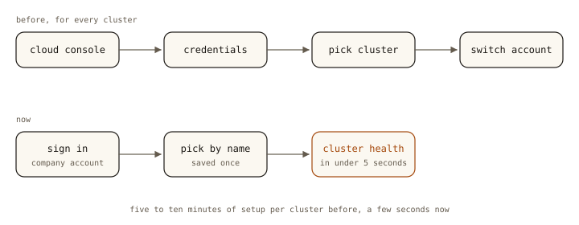
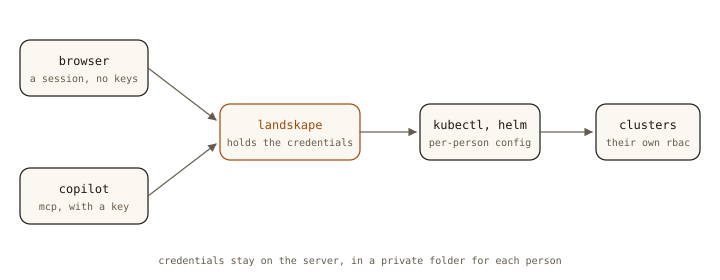
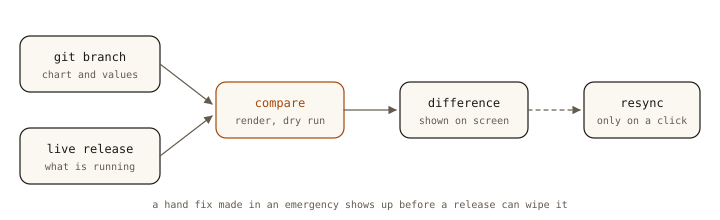
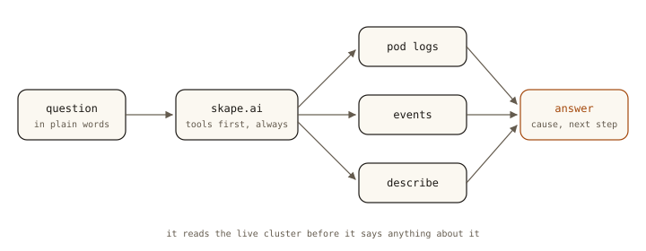

Our team moved to a new managed Kubernetes platform and lost a screen we used every day. Landskape gives it back: one sign-in, every cluster, and an assistant that answers from what is actually running.

## Five commands before one log line {#problem}

The new platform was more stable than the old one, but it had no web console. To read a single log line I had to open the cloud console, fetch credentials, pick the right cluster, switch to the right account, and only then type my question.

That was five to ten minutes per cluster, and we had several across test, pre-production and production. Checking a release in three of them could take 40 minutes before I saw anything useful. At two in the morning, with something broken, that setup is the last thing anyone wants.

## Why not an existing tool {#why}

I tried the popular ones, Lens and K9s among them. They are good tools, but they still need the same setup on every machine. They don't know the company sign-in, they don't handle the cloud login for us, and they can't keep one person's access apart from another's when a team shares them.

What we needed was simple to say: fast, safe access from the browser, using the sign-in people already have, with nothing to install. Nothing did that, so I built it.

## What it does {#what}

You sign in with your company account, pick a cluster by name, and see its health in under five seconds.

- **One overview.** Deployments, pods, stateful sets, daemon sets and jobs, each marked healthy, warning or failing. Counts of services, ingresses, config maps and volumes. The latest cluster events, warnings first. It replaces fourteen or more separate commands.
- **Saved connections.** Each environment is set up once. Moving between test, pre-production and production is one click.
- **Twenty-four resource types.** From pods and cron jobs to network policies, role bindings, autoscalers and cloud-specific certificates and backend settings.
- **Detail on demand.** Every resource opens to its description, metadata, full YAML (searchable), related events, resource requests and limits, logs with a time window from five minutes to a day, the pods behind it and the services in front of it.
- **Routes.** Every ingress and load balancer with its hosts and addresses, across all namespaces or one.
- **Helm.** Every release with its chart, version, values and history.
- **Small fixes, safely.** In test environments, a stuck pod or deployment can be restarted, a cron job run now, or a finished job removed. Each one asks you to confirm first, so nobody waits on a full pipeline for a restart.

## How it is built {#shape}

Landskape is one Next.js 16 app with React 19 and strict TypeScript. The pages use the App Router, Tailwind 4 and Radix, with CodeMirror for YAML and Recharts for charts. The API routes behind them are stateless, so any pod can answer any request.

The choice that surprises people: **it talks to Kubernetes by running kubectl and helm**, not through a client library. I chose that on purpose.

- Every call gets its own config file, so keeping people apart is one environment variable per call, easy to read and easy to check.
- The cloud login can run its normal device flow, with no token handling of my own.
- The results match what engineers see in their own terminals, so nothing has to be explained twice.

Around those calls sit a few guards:

- **A rate limiter.** A token bucket allows 20 calls a second, bursts of 30 and 10 at once. A queued call gives up after 30 seconds instead of piling up, so one busy screen can't flood the cluster's API.
- **Three layers of cache.** Lists and status are kept for five seconds and dropped when you switch cluster. Projects and cluster memberships are kept for a day on disk. The browser shows the last known view straight away and refreshes it quietly behind.

## Keeping access apart {#access}

Credentials never reach the browser. The browser only holds a session with a name and an email address.

- **Company sign-in.** Users sign in with the company identity provider through NextAuth. Its access token is large enough to push the session cookie past the browser's 4 KB limit, and the app only needs a name and an email, so only those are kept.
- **Cloud login without a terminal.** When a person needs to sign in to the cloud, the server starts the cloud CLI's device login, passes the consent link to the browser, and finishes the login on the server.
- **A private folder per person.** Each person's cluster configs, cloud login and saved connections live in their own folder on a persistent volume, keyed by their email. Every kubectl call is pointed at that folder and nowhere else.
- **The cluster decides.** Landskape adds no permissions of its own. If you can't see something in your terminal, you can't see it here, because the cluster's own access rules answer every call.
- **Service accounts by choice.** A person can switch one cluster connection to a named service account for a session. That choice is stored apart from their own login.

## Catching drift {#drift}

Sometimes someone fixes a problem by hand in an emergency and forgets to write it down. Weeks later a release overwrites the fix, and nobody notices until it breaks again.

Landskape compares each Helm release with the chart and values file it should come from, on a named Git branch. It renders the chart from Git, runs a dry-run upgrade against the live release, and shows any difference. Nothing is changed on its own. If you want the cluster to match Git again, you press resync and it runs the upgrade.

## Asking the cluster a question {#assistant}

Landskape has a built-in assistant, Skape.AI. You ask a plain question, such as "why is this pod failing?", and it checks the live cluster, reads the logs and recent events, and answers with the likely cause and what to try next. What took ten to twenty minutes takes about thirty seconds.

- **It always looks first.** Its first rule is to never answer a question about a resource without calling a tool. If one tool gives a partial picture, it goes on to the next: find the pod, describe it, read its events.
- **It has a method for logs.** A log analysis skill works in five steps: find the target, choose a time window, fetch the logs in chunks, read each chunk, then put the findings together. Two more skills cover day-to-day operations and network access.
- **Any model.** It runs on a local open-source model through Ollama by default, on OpenAI, or on any OpenAI-compatible service. Teams pick what their rules allow.
- **Streaming.** It uses the Vercel AI SDK, so tool calls and text stream to the screen as they happen.
- **It stays small.** Lists stop at 50 items, descriptions at 3,000 characters and logs at 200 lines, and a token counter keeps every prompt inside the model's window. Secret values are never shown.
- **It is easy to change.** The persona and skills are Markdown files read when the server starts, so changing how it behaves needs a restart, not a rebuild. On a small model the skills can be left out.

## The same tools in Copilot {#mcp}

Developers already had GitHub Copilot. Landskape lets that Copilot read the live cluster too, through an MCP server, so a developer can ask "what's failing?" from inside their editor. We bought nothing new. We gave a tool we already paid for access to real information.

- **Thirteen tools.** The same ones Skape.AI uses: cluster status and overview, lists, details, logs, log analysis, events, namespaces, Helm releases, routes, switching cluster, and actions.
- **Stateless over HTTP.** It uses the MCP streamable HTTP transport in stateless mode on one endpoint. Every request carries its own key and is checked on its own, so it scales across pods with no sticky sessions.
- **Keys kept as hashes.** A person creates a key in Landskape and sees it once. Only its SHA-256 hash is stored, and that hash finds the owner in one file read. Each key has a scope: read by default, or read plus actions if the person asks for it.
- **The same walls.** Every tool call runs with the key owner's own config and folder. Requests from unexpected origins are refused, which blocks DNS rebinding.

## Shipping it {#shipping}

- **Container.** A three-stage build (dependencies, build, run) on Node 20 Alpine, with the cloud CLI inside. It runs as a non-root user.
- **Helm.** A deployment, a service, a persistent volume for each person's folder, a network policy and the ingress settings. Secrets arrive as a mounted file, and the pod signs in to the cloud with workload identity, so no long-lived key is baked in.
- **CI.** GitHub Actions lints, runs the Vitest tests and builds on every change, then on the main branch builds the image with cached layers and pushes it tagged with the commit.

It deploys the same way as every other part of the application it serves, so adopting it needed no new process.

## Building it with AI {#ai}

I had a working prototype in under four working days and a production version in under four weeks, alongside my normal work. My estimate for a usual team is fourteen to eighteen weeks with two or three people.

- **Mine:** the research, the choice of tools, the security design, the code that handles credentials and keeps people apart, and the hard debugging.
- **The agent's, reviewed by me:** turning my plan into a written scope with GitHub Copilot, then the routine parts: screens, API routes, the tool definitions and their tests.

> AI helps most when a person brings a clear problem and firm limits. The limits are the part you can't hand over.

## What changed {#impact}

These are my estimates from the steps and times above, not measured results.

- **Connecting to a cluster** went from five to ten minutes to under thirty seconds.
- **Checking three environments** went from twenty to forty minutes to two or three.
- **Finding why a pod fails** went from ten to twenty minutes to about thirty seconds.
- **Daily cluster checks** went from forty to sixty minutes per developer to five to eight.

That is about 45 minutes a day for each developer, or roughly 75 hours a month for a team of five. On-call nights got much calmer too. Any team on the platform can start the same day, with no install and no new accounts.

## What I'd keep {#lessons}

- **Start from the annoyance.** "Too many steps before one log line" was a better brief than any feature list.
- **Keep credentials where people can't see them.** The browser holds a session, the server holds the keys, and the cluster makes the final call.
- **Boring tools can be the right call.** Running kubectl made isolation obvious and kept the results familiar.
- **Make the assistant look before it speaks.** Grounding every answer in a live tool call is what makes people trust it.
- **Reuse what you already pay for.** Connecting Copilot to the cluster cost nothing and reached every developer.

Next on the list: alerts when drift appears, an assistant that can help fix problems as well as explain them, a usage view for platform owners, and support for other clouds.
