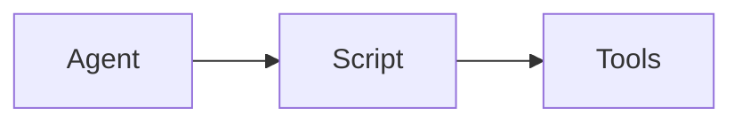

# 39. Writing pages

The Writing section of the site: an index at `/writing/` and one page per piece at `/writing/<slug>/`, for essays, research and case studies of private work. Drawn here inside the real site frame; nothing in `apps/portfolio` changes.

```bash
pnpm build
```

```bash
node prototypes/39-writing-pages/serve.mjs
```

Open `/writing/`, `/writing/sample-post/` and `/writing/sample-case-study/`.

## The menu

- The header's **Research** (an anchor on home) becomes **Writing**, the page: Builds, Writing, Experience, Contact. It fits phones at 320px, being shorter than Research.
- On writing pages it is marked as the current page, and the dock reads "Writing".
- Home keeps its Research & writing section; its All writing goes to `/writing/` instead of Substack. The dock list and the footer gain Writing.

## The index, `/writing/`

- The page title and lead, the count, and the builds page's lean filter chips: All, Research, Case studies, Essays (a kind shows only once it has a piece).
- Everything in one list, newest first, grouped by year (the year in mono on the left on wide screens, above on phones).
- Each row: the kind in mono, small outlined tags (IBM · Private, Sample), the title (one line on wide screens, wrapping on phones), a one-line summary, then the date, reading time and where it lives: Here, Substack ↗ or PDF ↗. Hovering a row lifts it on a faint surface.

## A piece, `/writing/<slug>/`

- All writing ← at the top, then the kind, date and reading time in mono, the title (up to 48px), and the summary as a dek.
- A reading column of about 66 characters (42rem, 17px, line height 1.7) in the site's own type; on wide screens its sections sit in a quiet sticky rail on the left ("On this page"), made from the post's `##` headings.
- Pull quotes have an amber rule (`--accent-warm`); code sits on the sunken surface in Geist Mono; links carry the site's dotted line.
- Pictures, sketches and diagrams are figures with a mono caption. Each loads only when it nears the screen (`loading="lazy"`) and has its true size, so nothing jumps. Drawings come in a light and a dark version; the theme shows one, and the hidden one never downloads.
- The foot: tags as small outlined pills, then the next piece.

## A case study

- The same page, plus an **At a glance** card under the title: Where (IBM · Private), Role, When, Team, Stack, up to two headline numbers, and the line "A private project: no code, data or client names are shared."
- Sections: Context, The problem, What I did, What changed, What I'd do differently. The sample's bracketed text marks where your words go.
- Case studies carry no repository or demo link, as the site's rules require for private work.

## How a post gets onto the site (to build next)

One folder per piece in the repository, picked up on the next build. No admin screen and no service: Git is the CMS.

```
content/writing/
  the-blind-script-notes/
    index.md          the post
    cover.png         any image, sketch or diagram it uses
    sketch.svg
```

```markdown
---
title: Sample post: what a writing page can hold
summary: One sentence for the list and for search results.
date: 2026-11-22
kind: essay            # essay | case-study | research
tags: [Design]
cover: cover.png       # optional
draft: false           # true keeps it off the site
# case studies only
private: IBM
role: Senior engineer
when: 2023 to 2025
team: 6
stack: [Java, Kafka, OpenShift]
numbers:
  - { value: "40%", label: "fewer failed runs" }
---

Write in Markdown. `## Headings` become the "On this page" rail.



```

At build time, before the site is drawn:

- **Front matter is checked** against a typed schema (the same way builds are); a missing title, a bad date or an unknown kind fails the build with the file's name.
- **The slug** is the folder name, so the address is `/writing/<folder>/`. Each piece gets its own HTML page, title, description, social image and a place in the sitemap and RSS feed, like every other page.
- **Markdown becomes HTML once, at build time,** so a post ships no Markdown parser and no extra script: the page is text and images.
- **Images** are turned into WebP at two widths with their sizes recorded, so they load lazily without jumping.
- **Diagrams** written as `mermaid` blocks are drawn into still SVGs, a light and a dark one, by the headless browser the build already uses. No diagram library reaches the visitor.
- **Sketches** are SVG files used as they are.
- **The index and home** read the same list, with the Substack feed and the paper merged in, newest first.
- **Drafts** stay out of the build; nothing on the site until it's decided.
